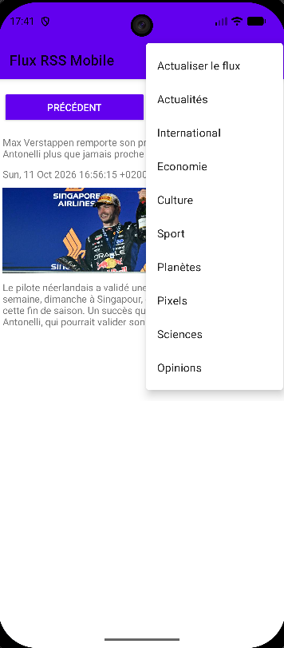

# Android RSS News Reader


An Android news reader that loads articles from the RSS feeds of the French daily *Le Monde*, displays them one at a time, and keeps working offline thanks to a local cache.

Built individually in Java as part of the mobile programming course at ENSICAEN (engineering school, Caen, France).

<p align="center">
  
  
</p>

## Features

- **Nine news categories**: Headlines, International, Economy, Culture, Sport, Planet, Pixels (tech), Sciences and Opinions, selectable from the app menu (the interface is in French, like the feeds).
- **Article view** with title, publication date, description and image, plus *Previous* / *Next* buttons that stay visible while the article content scrolls.
- **In-memory navigation**: a feed is parsed once, then browsing between articles requires no further network calls.
- **Offline mode**: when a network connection is available, articles and their images are saved to a local Room (SQLite) database, per category. Without a connection, the app reads from this cache.
- **Manual refresh** from the menu, to reload the current feed and update the cache.

## Architecture

The app follows the **MVVM** pattern (Model–View–ViewModel):

| Layer | Class | Role |
|---|---|---|
| View | `MainActivity` | Displays the current article, handles the menu and buttons, observes the ViewModel |
| ViewModel | `RssFeedViewModel` | Holds the list of articles and the current position, exposed through `LiveData` |
| Parsing | `RssSaxHandler` | Streams the RSS XML with a SAX parser and extracts title, description, date and image URL |
| Persistence | `AppDatabase`, `RssItemDao`, `RssItemEntity` | Room database used as an offline cache |
| Utilities | `NetworkUtility`, `BitmapUtility` | Network availability check; image download and Bitmap ↔ byte array conversion |

### Data flow

```
Menu selection
     │
     ▼
ExecutorService (background thread)
     │
     ├── Network available ──► SAX parsing of the RSS feed ──► ViewModel
     │                                     │
     │                                     └──► Room cache (articles + compressed images)
     │
     └── No network ─────────► Room cache ──► ViewModel
                                                   │
                                                   ▼
                                     LiveData ──► MainActivity (UI thread)
```

Network access and XML parsing never run on the UI thread: Android forbids network calls on the main thread, so all loading goes through a single-thread `ExecutorService`, and the UI is updated by observing `LiveData`.

## Tech stack

- **Language:** Java 11
- **Platform:** Android (minimum SDK 24, Android 7.0)
- **Architecture components:** ViewModel, LiveData, View Binding
- **Persistence:** Room
- **XML parsing:** SAX (`javax.xml.parsers`)
- **Build:** Gradle (Kotlin DSL, version catalog)
- **Testing:** JUnit 4
- **CI:** GitHub Actions

## Getting started

1. Clone the repository.
2. Open the project in Android Studio and let Gradle sync.
3. Run the app on an emulator or a device running Android 7.0 or later.

The app requires the `INTERNET` and `ACCESS_NETWORK_STATE` permissions, declared in the manifest.

## Testing

Unit tests run on the JVM (no emulator needed) and are executed on every push by GitHub Actions.

- `RssSaxHandlerTest`: parsing of RSS items, text split across several SAX callbacks (entities, character references), trimming of CDATA content, no field leaking from one item to the next.
- `RssFeedViewModelTest`: mapping of cached Room entities back to articles.

```bash
./gradlew testDebugUnitTest
```

In Android Studio, right-click the `etu.ecole.fluxrssmobile (test)` package and choose **Run Tests**.

## Project structure

```
app/src/main/java/etu/ecole/fluxrssmobile/
├── MainActivity.java          # View: UI, menu, observers
├── NetworkUtility.java        # Network availability check
├── BitmapUtility.java         # Image download and conversion
├── rss/
│   ├── RssFeedViewModel.java  # ViewModel: articles and navigation
│   ├── RssItemModel.java      # Article model
│   └── RssSaxHandler.java     # SAX parser for RSS feeds
└── database/
    ├── AppDatabase.java       # Room database
    ├── RssItemDao.java        # Queries (insert, read and clear by category)
    └── RssItemEntity.java     # Cached article

app/src/test/java/etu/ecole/fluxrssmobile/rss/
├── RssSaxHandlerTest.java     # Parser unit tests
└── RssFeedViewModelTest.java  # Cache mapping unit tests

.github/workflows/android-ci.yml  # CI: runs unit tests on every push
```

## Known limitations

- Images are downloaded during XML parsing, which slows down the first display of a feed.

## Disclaimer

This is an academic project. It is not affiliated with or endorsed by *Le Monde*. All article content belongs to its publisher and is accessed through its public RSS feeds.

## Author

Nicolas Peyregne — [LinkedIn](https://linkedin.com/in/nicolas-peyregne)